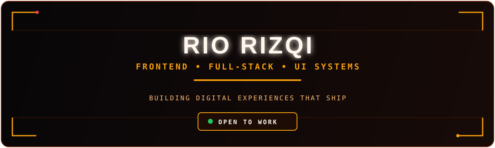
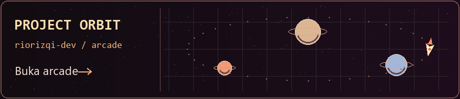
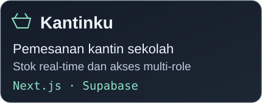
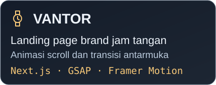
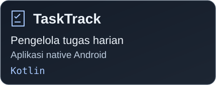

<div align="center">
  
</div>

<p align="center">
  <a href="mailto:riorizqi918@gmail.com"></a>
  <a href="https://www.linkedin.com/in/rio-rizqi-saputra-a86441417"></a>
  <a href="https://www.instagram.com/riio_gorioio"></a>
  <a href="https://github.com/riorizqi-dev"></a>
  <a href="https://portfolio-rio-green.vercel.app/"></a>
</p>

<p align="center">
  <a href="#proyek-pilihan">Jelajahi proyek</a> ·
  <a href="#contribution-arcade">Lihat arcade</a> ·
  <a href="#guestbook">Isi guestbook</a>
</p>

## Tentang aku

Aku **Rio Rizqi Saputra**. Di GitHub aku bikin sistem pemesanan sekolah, aplikasi Android, dan eksperimen visual seperti landing page dengan animasi dan RPG pixel art.

- **Web** · Pemesanan kantin dengan stok real-time di Kantinku.
- **Android** · Pengelola tugas harian dengan Kotlin di TaskTrack.
- **Game** · Cerita slice of life dengan Godot di Langkah Pertama di Kota.

<div align="center">
  <a href="#contribution-arcade"></a>
</div>

## Proyek pilihan

<p align="center">
  <a href="https://github.com/riorizqi-dev/kantinku"></a>
  <a href="https://github.com/riorizqi-dev/vantor"></a>
  <br/>
  <a href="https://github.com/riorizqi-dev/TaskTrack"></a>
  <a href="https://github.com/riorizqi-dev/langkah-pertama-di-kota"></a>
</p>

Proyek lain · [Cafe Yo](https://github.com/riorizqi-dev/cafe-yo) · [RFM Market](https://github.com/riorizqi-dev/rfm-market) · [The Killer](https://github.com/riorizqi-dev/the-killer)

<details>
<summary><strong>Lihat isi bengkel proyek</strong></summary>

- [Kantinku](https://github.com/riorizqi-dev/kantinku) · Web pemesanan kantin, stok real-time, dan akses untuk beberapa peran.
- [VANTOR](https://github.com/riorizqi-dev/vantor) · Eksperimen motion untuk landing page jam tangan dengan GSAP dan Framer Motion.
- [TaskTrack](https://github.com/riorizqi-dev/TaskTrack) · Aplikasi pengelola tugas harian yang ditulis dengan Kotlin.
- [Langkah Pertama di Kota](https://github.com/riorizqi-dev/langkah-pertama-di-kota) · RPG 2D naratif dengan visual pixel art dan Godot 4.

</details>

## Perjalanan di GitHub

| Waktu | Catatan publik |
| :-- | :-- |
| Nov 2025 | Akun GitHub dibuat |
| Agu 2026 | Repo Kantinku, VANTOR, dan TaskTrack dibuat |
| Okt 2026 | Repo Langkah Pertama di Kota dibuat |

## Tech stack

<div align="center">
  
</div>

- **Web** · TypeScript, React, Next.js, Tailwind CSS, GSAP, Framer Motion
- **Data & backend** · Supabase, MySQL, ASP.NET Core
- **Android & game** · Kotlin, Godot 4, GDScript

## Statistik GitHub

<div align="center">
  
  
</div>

<div align="center">
  
</div>

## Kontribusi 3D

[](https://github.com/riorizqi-dev#contribution-activity)

Peta kontribusi publik per 19 Nov 2026.

## Contribution arcade

**[Main CardFlip](https://cardflip-plum.vercel.app/)** · Game memory matching buatanku dengan tiga tingkat kesulitan. [Lihat repo](https://github.com/riorizqi-dev/cardflip).

Galaga dan Snake di bawah ini adalah animasi dari kalender kontribusiku.

<details open>
<summary><strong>Galaga</strong></summary>

<div align="center">
  <picture>
    <source media="(prefers-color-scheme: dark)" srcset="https://raw.githubusercontent.com/riorizqi-dev/riorizqi-dev/output/galaga-contribution-graph-dark.svg" />
    <source media="(prefers-color-scheme: light)" srcset="https://raw.githubusercontent.com/riorizqi-dev/riorizqi-dev/output/galaga-contribution-graph.svg" />
    
  </picture>
</div>

</details>

<details>
<summary><strong>Snake</strong></summary>

<div align="center">
  <picture>
    <source media="(prefers-color-scheme: dark)" srcset="https://raw.githubusercontent.com/riorizqi-dev/riorizqi-dev/output/snake-dark.svg" />
    <source media="(prefers-color-scheme: light)" srcset="https://raw.githubusercontent.com/riorizqi-dev/riorizqi-dev/output/snake-light.svg" />
    
  </picture>
</div>

</details>


## Guestbook

[✍️ Tulis salam](https://github.com/riorizqi-dev/riorizqi-dev/issues/new?template=guestbook.yml) · [Baca salam pengunjung](https://github.com/riorizqi-dev/riorizqi-dev/issues?q=is%3Aissue+in%3Atitle+%22Guestbook%3A%22)

<details>
<summary><strong>Easter egg · Buka transmisi terakhir</strong></summary>

```text
> scan --kota
Sinyal ditemukan di jalur menuju kota.
```

[Ikuti sinyal ke Langkah Pertama di Kota](https://github.com/riorizqi-dev/langkah-pertama-di-kota)

</details>

<p align="center">
  <a href="https://github.com/riorizqi-dev/langkah-pertama-di-kota"></a>
</p>
