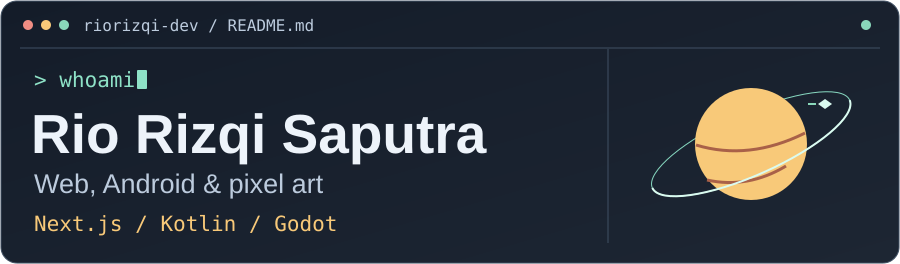
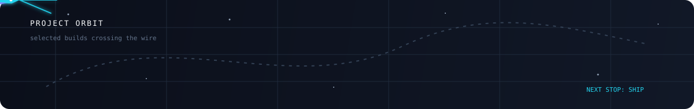
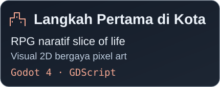
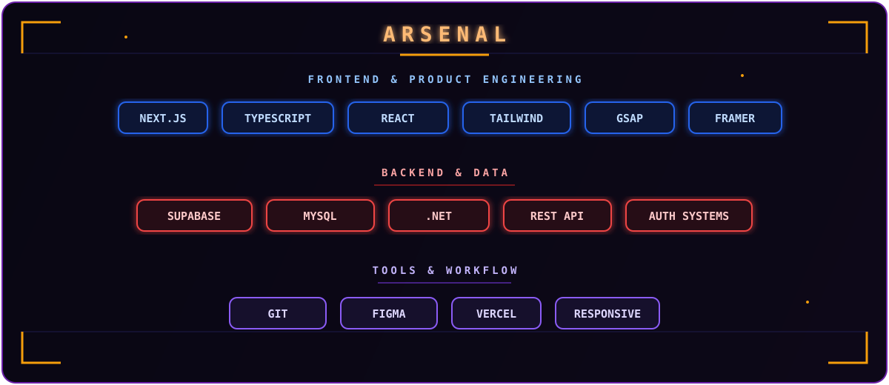

  

  
  
  
  
  

## Tentang aku

Aku **Rio Rizqi Saputra**. Di GitHub aku bikin sistem pemesanan sekolah, aplikasi Android, dan eksperimen visual seperti landing page dengan animasi dan RPG pixel art.

- **Web** · Pemesanan kantin dengan stok real-time di Kantinku.
- **Android** · Pengelola tugas harian dengan Kotlin di TaskTrack.
- **Game** · Cerita slice of life dengan Godot di Langkah Pertama di Kota.

  

## Proyek pilihan

  
  
   
  
  

Proyek lain · [Cafe Yo](https://github.com/riorizqi-dev/cafe-yo) · [RFM Market](https://github.com/riorizqi-dev/rfm-market) · [The Killer](https://github.com/riorizqi-dev/the-killer)

## Perjalanan di GitHub

| Waktu | Catatan publik |
| :-- | :-- |
| Nov 2025 | Akun GitHub dibuat |
| Agu 2026 | Repo Kantinku, VANTOR, dan TaskTrack dibuat |
| Okt 2026 | Repo Langkah Pertama di Kota dibuat |

## Tech stack

  

- **Web** · TypeScript, React, Next.js, Tailwind CSS, GSAP, Framer Motion
- **Data & backend** · Supabase, MySQL, ASP.NET Core
- **Android & game** · Kotlin, Godot 4, GDScript

## Statistik GitHub

  
  

  

## Contribution arcade

### Galaga

  <picture>
    <source media="(prefers-color-scheme: dark)" srcset="https://raw.githubusercontent.com/riorizqi-dev/riorizqi-dev/output/galaga-contribution-graph-dark.svg" />
    <source media="(prefers-color-scheme: light)" srcset="https://raw.githubusercontent.com/riorizqi-dev/riorizqi-dev/output/galaga-contribution-graph.svg" />
    
  </picture>

### Snake

  <picture>
    <source media="(prefers-color-scheme: dark)" srcset="https://raw.githubusercontent.com/riorizqi-dev/riorizqi-dev/output/snake-dark.svg" />
    <source media="(prefers-color-scheme: light)" srcset="https://raw.githubusercontent.com/riorizqi-dev/riorizqi-dev/output/snake-light.svg" />
    
  </picture>

## Guestbook

[Sampein salam lewat GitHub Issues](https://github.com/riorizqi-dev/riorizqi-dev/issues/new?title=Guestbook%3A%20Halo%20Rio)
