# Rio Rizqi Saputra

Aku bikin aplikasi web dan Android, dari sistem pemesanan kantin sampai aplikasi pengelola tugas. Di luar itu aku juga bikin landing page dengan animasi dan RPG bergaya pixel art.

[Portofolio](https://github.com/riorizqi-dev/portfolio-rio) · [LinkedIn](https://www.linkedin.com/in/rio-rizqi-saputra-a86441417) · [Semua repositori](https://github.com/riorizqi-dev?tab=repositories)

## Proyek pilihan

| Proyek | Yang kubangun |
| :-- | :-- |
| [Kantinku](https://github.com/riorizqi-dev/kantinku) | Pemesanan kantin sekolah dengan stok real-time dan akses untuk beberapa peran. **Next.js · Supabase** |
| [VANTOR](https://github.com/riorizqi-dev/vantor) | Landing page jam tangan dengan animasi saat scroll. **Next.js · GSAP · Framer Motion** |
| [TaskTrack](https://github.com/riorizqi-dev/TaskTrack) | Aplikasi Android untuk mengelola tugas harian. **Kotlin** |
| [Langkah Pertama di Kota](https://github.com/riorizqi-dev/langkah-pertama-di-kota) | RPG naratif 2D bergaya pixel art. **Godot 4 · GDScript** |

## Kontribusi

<picture>
  <source media="(prefers-color-scheme: dark)" srcset="https://raw.githubusercontent.com/riorizqi-dev/riorizqi-dev/output/galaga-contribution-graph-dark.svg">
  
</picture>
