<picture>
  <source media="(max-width: 768px)" srcset="https://raw.githubusercontent.com/riorizqi-dev/riorizqi-dev/main/assets/hiro-template/m/header.svg?v=3" />
  
</picture>

 

<picture>
  <source media="(max-width: 768px)" srcset="https://raw.githubusercontent.com/riorizqi-dev/riorizqi-dev/main/assets/hiro-template/m/section-about.svg?v=3" />
  
</picture>

Aku **Rio Rizqi Saputra**. Aku bikin aplikasi web, Android, dan game pixel art.

**Yang aku bangun**

- [Kantinku](https://github.com/riorizqi-dev/kantinku) · Sistem pemesanan kantin sekolah.
- [VANTOR](https://github.com/riorizqi-dev/vantor) · Landing page jam tangan dengan GSAP dan Framer Motion.
- [TaskTrack](https://github.com/riorizqi-dev/TaskTrack) · Pengelola tugas harian berbasis Kotlin.
- [Langkah Pertama di Kota](https://github.com/riorizqi-dev/langkah-pertama-di-kota) · RPG naratif 2D dengan Godot.

<picture>
  <source media="(max-width: 768px)" srcset="https://raw.githubusercontent.com/riorizqi-dev/riorizqi-dev/main/assets/hiro-template/m/neofetch.svg?v=3" />
  
</picture>

> *Stay curious, keep exploring, and never stop building.* 🚀

<picture>
  <source media="(max-width: 768px)" srcset="https://raw.githubusercontent.com/riorizqi-dev/riorizqi-dev/main/assets/hiro-template/m/divider.svg?v=3" />
  
</picture>

<picture>
  <source media="(max-width: 768px)" srcset="https://raw.githubusercontent.com/riorizqi-dev/riorizqi-dev/main/assets/hiro-template/m/section-projects.svg?v=3" />
  
</picture>

<a href="https://github.com/riorizqi-dev/kantinku"></a>
<a href="https://github.com/riorizqi-dev/vantor"></a>
<a href="https://github.com/riorizqi-dev/TaskTrack"></a>
<a href="https://github.com/riorizqi-dev/langkah-pertama-di-kota"></a>

<picture>
  <source media="(max-width: 768px)" srcset="https://raw.githubusercontent.com/riorizqi-dev/riorizqi-dev/main/assets/hiro-template/m/section-journey.svg?v=3" />
  
</picture>

<picture>
  <source media="(max-width: 768px)" srcset="https://raw.githubusercontent.com/riorizqi-dev/riorizqi-dev/main/assets/hiro-template/m/timeline.svg?v=3" />
  
</picture>

<picture>
  <source media="(max-width: 768px)" srcset="https://raw.githubusercontent.com/riorizqi-dev/riorizqi-dev/main/assets/hiro-template/m/divider.svg?v=3" />
  
</picture>

- **Web** · TypeScript, React, Next.js, Tailwind, GSAP, Framer Motion
- **Backend** · Supabase, MySQL, ASP.NET Core
- **Android & game** · Kotlin, Godot, GDScript

<picture>
  <source media="(max-width: 768px)" srcset="https://raw.githubusercontent.com/riorizqi-dev/riorizqi-dev/main/assets/hiro-template/m/marquee.svg?v=3" />
  
</picture>

- **Web** · TypeScript, React, Next.js, Tailwind, GSAP, Framer Motion
- **Backend** · Supabase, MySQL, ASP.NET Core
- **Android & game** · Kotlin, Godot, GDScript

<picture>
  <source media="(max-width: 768px)" srcset="https://raw.githubusercontent.com/riorizqi-dev/riorizqi-dev/main/assets/hiro-template/m/section-ai.svg?v=3" />
  
</picture>

Profil ini dikerjakan dengan bantuan Codex.

<picture>
  <source media="(max-width: 768px)" srcset="https://raw.githubusercontent.com/riorizqi-dev/riorizqi-dev/main/assets/hiro-template/m/divider.svg?v=3" />
  
</picture>

<picture>
  <source media="(max-width: 768px)" srcset="https://raw.githubusercontent.com/riorizqi-dev/riorizqi-dev/main/assets/hiro-template/m/section-stats.svg?v=3" />
  
</picture>

<picture>
  <source media="(max-width: 768px)" srcset="https://raw.githubusercontent.com/riorizqi-dev/riorizqi-dev/main/assets/hiro-template/m/section-city.svg?v=3" />
  
</picture>

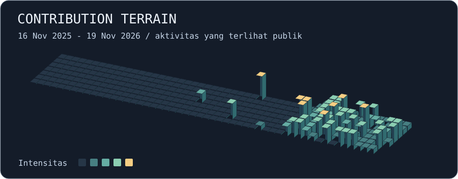

<picture>
  <source media="(max-width: 768px)" srcset="https://raw.githubusercontent.com/riorizqi-dev/riorizqi-dev/main/assets/hiro-template/m/divider.svg?v=3" />
  
</picture>

<picture>
  <source media="(max-width: 768px)" srcset="https://raw.githubusercontent.com/riorizqi-dev/riorizqi-dev/main/assets/hiro-template/m/section-arcade.svg?v=3" />
  
</picture>

Animasi dari kalender kontribusiku. **[Main CardFlip](https://cardflip-plum.vercel.app/)** untuk mencoba game buatanku.

**🐍 Snake**

<picture>
  <source media="(prefers-color-scheme: dark)" srcset="https://raw.githubusercontent.com/riorizqi-dev/riorizqi-dev/output/snake-dark.svg" />
  <source media="(prefers-color-scheme: light)" srcset="https://raw.githubusercontent.com/riorizqi-dev/riorizqi-dev/output/snake-light.svg" />
  
</picture>

**👾 Pac-Man**

<picture>
  <source media="(prefers-color-scheme: dark)" srcset="https://raw.githubusercontent.com/riorizqi-dev/riorizqi-dev/output/pacman-contribution-graph-dark.svg" />
  <source media="(prefers-color-scheme: light)" srcset="https://raw.githubusercontent.com/riorizqi-dev/riorizqi-dev/output/pacman-contribution-graph.svg" />
  
</picture>

**🧱 Breakout**

<picture>
  <source media="(prefers-color-scheme: dark)" srcset="https://raw.githubusercontent.com/riorizqi-dev/riorizqi-dev/output/breakout-contribution-graph-dark.svg" />
  <source media="(prefers-color-scheme: light)" srcset="https://raw.githubusercontent.com/riorizqi-dev/riorizqi-dev/output/breakout-contribution-graph.svg" />
  
</picture>

<picture>
  <source media="(max-width: 768px)" srcset="https://raw.githubusercontent.com/riorizqi-dev/riorizqi-dev/main/assets/hiro-template/m/divider.svg?v=3" />
  
</picture>

<picture>
  <source media="(max-width: 768px)" srcset="https://raw.githubusercontent.com/riorizqi-dev/riorizqi-dev/main/assets/hiro-template/m/section-guestbook.svg?v=3" />
  
</picture>

Isi formulir untuk menyapa, atau <a href="https://github.com/riorizqi-dev/riorizqi-dev/issues?q=is%3Aissue+in%3Atitle+%22Guestbook%3A%22">baca salam pengunjung</a>.

  

<picture>
  <source media="(max-width: 768px)" srcset="https://raw.githubusercontent.com/riorizqi-dev/riorizqi-dev/main/assets/hiro-template/m/section-break.svg?v=3" />
  
</picture>

<picture>
  <source media="(max-width: 768px)" srcset="https://raw.githubusercontent.com/riorizqi-dev/riorizqi-dev/main/assets/hiro-template/m/break.svg?v=3" />
  
</picture>

**Makasih sudah mampir!**

🥚 <b>psst... click me</b>

 

[Buka Langkah Pertama di Kota](https://github.com/riorizqi-dev/langkah-pertama-di-kota) 🎮

<picture>
  <source media="(max-width: 768px)" srcset="https://raw.githubusercontent.com/riorizqi-dev/riorizqi-dev/main/assets/hiro-template/m/footer.svg?v=3" />
  
</picture>
