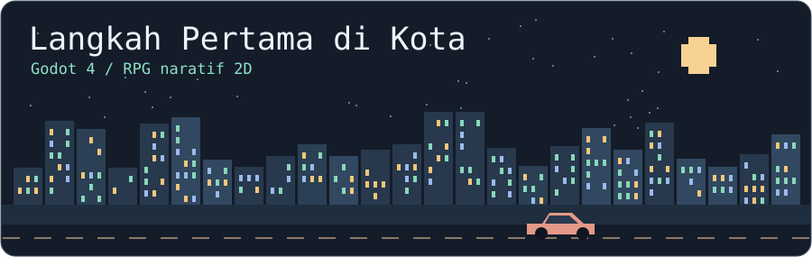
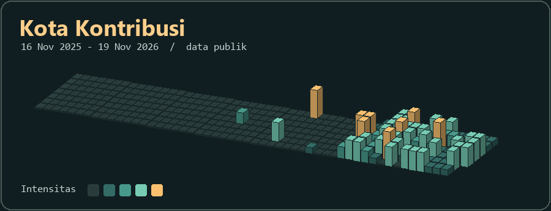
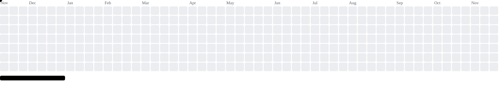

# Rio Rizqi Saputra

Aku bikin aplikasi web dan Android, landing page dengan motion, dan game pixel art.

[Portofolio](https://portfolio-rio-green.vercel.app/) · [LinkedIn](https://www.linkedin.com/in/rio-rizqi-saputra-a86441417/) · [Instagram](https://www.instagram.com/riio_gorioio/) · [Email](mailto:riorizqi918@gmail.com)

## Langkah Pertama di Kota

RPG naratif 2D bergaya pixel art, dibuat dengan Godot 4 dan GDScript. **[Lihat proyek](https://github.com/riorizqi-dev/langkah-pertama-di-kota)**

### Dari web ke Android

| Proyek | Yang kubangun |
| :-- | :-- |
| **[Kantinku](https://github.com/riorizqi-dev/kantinku)** | Pemesanan kantin sekolah dengan stok real-time dan akses multi-role. **Next.js · Supabase** |
| **[VANTOR](https://github.com/riorizqi-dev/vantor)** | Landing page jam tangan dengan animasi scroll. **Next.js · GSAP · Framer Motion** |
| **[TaskTrack](https://github.com/riorizqi-dev/TaskTrack)** | Aplikasi Android untuk mengatur tugas harian. **Kotlin** |

## Kota Kontribusi

Lihat streak dan grafik aktivitas

## Arcade

**[Main CardFlip](https://cardflip-plum.vercel.app/)** · Cocokkan kartu logo teknologi dalam tiga tingkat kesulitan. [Lihat repo](https://github.com/riorizqi-dev/cardflip).

Pac-Man · animasi kontribusi

<picture>
  <source media="(prefers-color-scheme: dark)" srcset="https://raw.githubusercontent.com/riorizqi-dev/riorizqi-dev/output/pacman-contribution-graph-dark.svg" />
  <source media="(prefers-color-scheme: light)" srcset="https://raw.githubusercontent.com/riorizqi-dev/riorizqi-dev/output/pacman-contribution-graph.svg" />
  
</picture>

Snake · animasi kontribusi

<picture>
  <source media="(prefers-color-scheme: dark)" srcset="https://raw.githubusercontent.com/riorizqi-dev/riorizqi-dev/output/snake-dark.svg" />
  <source media="(prefers-color-scheme: light)" srcset="https://raw.githubusercontent.com/riorizqi-dev/riorizqi-dev/output/snake-light.svg" />
  
</picture>

Breakout · animasi kontribusi

<picture>
  <source media="(prefers-color-scheme: dark)" srcset="https://raw.githubusercontent.com/riorizqi-dev/riorizqi-dev/output/breakout-contribution-graph-dark.svg" />
  <source media="(prefers-color-scheme: light)" srcset="https://raw.githubusercontent.com/riorizqi-dev/riorizqi-dev/output/breakout-contribution-graph.svg" />
  
</picture>

## Guestbook

[✍️ Tulis salam](https://github.com/riorizqi-dev/riorizqi-dev/issues/new?template=guestbook.yml) · [Baca salam pengunjung](https://github.com/riorizqi-dev/riorizqi-dev/issues?q=is%3Aissue+in%3Atitle+%22Guestbook%3A%22)
